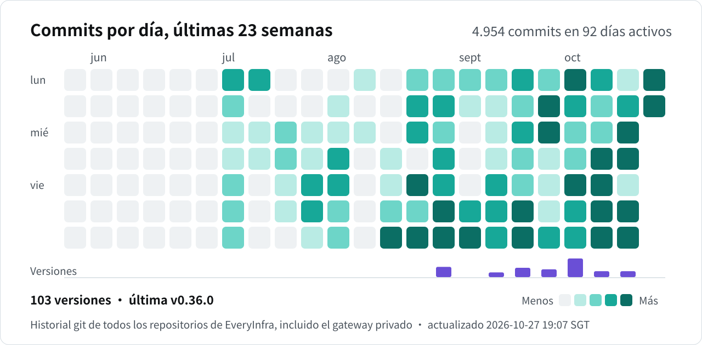

  <picture>
    <source media="(prefers-color-scheme: dark)" srcset="../docs/assets/hero-dark.svg">
    <source media="(prefers-color-scheme: light)" srcset="../docs/assets/hero-light.svg">
    
  </picture>

# Jev Radar 📡

### El informe de campo independiente sobre el ecosistema Jev, con cada entrada calificada por su evidencia

    

**[English](../README.md#english) · [简体中文](../README.md#中文) · Español**

---

## ¿Qué es Jev?

Jev es el primer modelo *System One* de TypeSafe AI, publicado el **15 de septiembre de 2026**. No escribe ni una frase. Le envías un estado sin estructurar y un conjunto de preguntas tipadas, y te devuelve decisiones sobre las que tu código puede ramificar directamente:

| Primitiva | Qué pregunta responde | Qué devuelve |
|---|---|---|
| **Noul** | ¿Esto es cierto? | Una probabilidad calibrada entre 0 y 1 |
| **Choice** | ¿Qué opción encaja? | La distribución completa y su confianza |
| **Score** | ¿Qué tan bueno es, según tu rúbrica? | Una nota ponderada por probabilidad |

Lo que lo puso en boca de todo el mundo en la comunidad de desarrollo: latencia de extremo a extremo de **70 a 500 ms** y **$0.042 por millón de tokens de entrada, con la salida gratis**, entre 20 y 200 veces más rápido y entre 40 y 400 veces más barato que pasar los mismos juicios por un LLM de frontera.

## Qué es este repositorio

En sus primeros cinco días, el ecosistema Jev superó los **1,000 repositorios** (más de 21,600 estrellas al cuarto día). Jev Radar es un intento independiente de responder con evidencia a una sola pregunta: **¿qué está construyendo de verdad la gente con esto?**

Cada caso se verificó contra una fuente primaria: un repositorio que abrimos, una demo en vivo que probamos o la publicación original de su autoría. Nada de rumores ni de listas infladas. Desde el 2026-09-19 un barrido automático (GitHub · X · cinco directorios de la comunidad) recoge candidatos; lo nuevo se verifica, se califica y se sube al repositorio. Último escaneo: 25-10-2026.

## Por qué puedes fiarte

Cada entrada estructurada del registro (108 en el primer lote del 2026-09-19, 1,227 tras el último barrido del 2026-10-25) lleva un bloque `verification` asignado durante la investigación:

| Nivel | Confianza | Cómo se gana |
|---|---|---|
| **A** | 0.90 | Revisamos el artefacto: leímos el README del repositorio, cargamos la página en vivo, leímos la publicación original completa o llamamos a la API |
| **B** | 0.75 | Hay una fuente primaria en el expediente (repositorio o publicación original), revisada a nivel de descripción |
| **C** | 0.60 | Solo aparece en un directorio; sube de nivel en el siguiente barrido, cuando se abre |

Cohorte original de verificación de casos del 2026-09-19: **38 × A · 70 × B · 0 × C**. Distribución del registro tras el último barrido: 1,227 entradas, A 562 · B 665. Las cifras dentro de cada entrada son **las que declara su autoría**, salvo que se marquen como reproducidas. También documentamos lo que *no* funciona: confianza no es acierto, la sensibilidad al orden y una ola de demos falsas aceleradas, con indicaciones sobre qué repositorios tienen trazas reales.

## Qué se está construyendo (por densidad)

1. **Seguridad y supervisión de agentes**: Jev como «segundo par de ojos» en cada llamada a herramientas. Referente: [`pi-warden`](https://github.com/DevMortimer/pi-warden), autoevaluado sobre 17,000 llamadas reales (88 % de las retenciones acertadas).
2. **Compactación de contexto**: puntuar cada resultado de herramienta y quedarse con lo que importa. [`fast-jev-compaction`](https://github.com/tamaratran/fast-jev-compaction) va en cabeza con 2.7k★.
3. **Enrutado de modelos**: más de 10 implementaciones; [`jev-codex-router`](https://github.com/0xNatoshi/jev-codex-router) midió **−60 % de coste** en una prueba retrospectiva de 237 turnos.
4. **Capas de decisión en tiempo real**: navegador (reserva de un vuelo en 7.1 s), voz (~300 ms por frase), juegos (Pokémon, StarCraft y Tetris a velocidad sobrehumana).
5. **Puntuación de contenido y crecimiento**: 61 preguntas por borrador de publicación por $0.0004; 724 anuncios de la competencia desmontados por $0.09.
6. **Trading**: una decisión por cada bloque de 300 ms de una cadena de bloques ([`jev-trader`](https://github.com/jarrodwatts/jev-trader)); ya hay primeras cifras honestas de operaciones simuladas.
7. **Jev como primitiva de sistemas**: predicados en Postgres y DuckDB, capas sobre pandas, historial de zsh, Neovim, Emacs.
8. **Llegan los verticales**: formularios fiscales (100 % de acierto estricto en 261 formularios del IRS), predicción de resoluciones judiciales, cribado de PubMed, flujos comerciales.

## Lecciones de campo

- **Hazle preguntas estrechas y mecánicas**: «los LLM sobreviven a una entrada basura; Jev no».
- **Las listas largas de opciones se hunden**: un Choice de 12 opciones obtuvo 0.40 con datos contables reales.
- **La confianza no es un aval**: en una gran evaluación independiente, las filas con confianza ≥ 0.9 solo acertaron el 72.2 %.
- **El orden y la redacción importan**: el orden de la evidencia cambia el 5.8 % de los fallos de un verificador.
- **El ahorro es real**: $1.43 por 34.1 M de tokens; $0.00003 por turno enrutado; $0.0002 por decisión de voz.

## Contenido del repositorio

| Ruta | Qué es |
|---|---|
| [`CASEBOOK.md`](../CASEBOOK.md) | El casebook completo: 14 secciones, fuentes y enlaces a publicaciones por caso, 10 registros de barridos en profundidad |
| [`data/projects.json`](../data/projects.json) | Registro legible por máquina con un esquema uniforme que incluye `verification {tier, method, confidence}` |
| [`docs/jev-api-access-guide.zh.md`](../docs/jev-api-access-guide.zh.md) | **Guía de acceso a la API de Jev** (en chino): la lista de espera paso a paso, el correo para acelerarla y alternativas sin espera |
| [`skills/jev-radar-briefing/SKILL.md`](../skills/jev-radar-briefing/SKILL.md) | **Skill de un solo archivo para empezar y recibir un resumen diario**: se instala en cualquier agente compatible con SKILL.md; incluye un script de shell que funciona sin agente |

**Fuentes barridas:** awesome-typesafe · awesomejev.com · madewithjev.com · risetive.com/jev · jevable.com · typesafeai.app · GitHub Search · X · Reddit · HN · V2EX/linux.do/Bilibili · YouTube · LinkedIn.

## Contribuir

¿Falta un proyecto? Abre un issue o un PR con: **URL del proyecto + URL de la publicación original (si la hay) + primitivas usadas + cualquier cifra medida.** No se aceptan envíos sin fuente primaria.

## Licencia y aviso

Contenido: **CC BY 4.0** · Datos: **CC0**. Investigación comunitaria independiente, **sin relación con TypeSafe AI**. Las métricas son las que declara cada autoría; el número de estrellas es una instantánea del 2026-09-19.

## Sobre EveryInfra (quién mantiene esto)

Jev Radar lo inició y lo mantiene [EveryInfra](https://everyinfra.com/es?utm_source=github&utm_medium=readme&utm_campaign=jev-radar&utm_content=maintainer_note_es), infraestructura de datos públicos, búsqueda web y CAPTCHA para productos de IA. Un informe independiente se gana la confianza diciendo quién lo mantiene: los criterios editoriales, la calificación de confianza y los registros de barrido son públicos en este repositorio. Si tu proyecto con Jev necesita datos en vivo para decidir, mira el [plugin de código abierto para agentes](https://github.com/everyinfra/everyinfra-agent-plugins/blob/main/i18n/README.es.md).

### Actividad de desarrollo

<!-- readme-stats: charts are regenerated daily, do not edit by hand -->

Commits por día en todos los repositorios de EveryInfra, incluido el gateway privado (solo recuentos), y versiones por semana. El gráfico se regenera cada día y muestra su hora de actualización.

<picture>
  <source media="(prefers-color-scheme: dark)" srcset="../docs/assets/readme-stats/activity-es-dark.svg">
  <source media="(prefers-color-scheme: light)" srcset="../docs/assets/readme-stats/activity-es-light.svg">
  
</picture>
